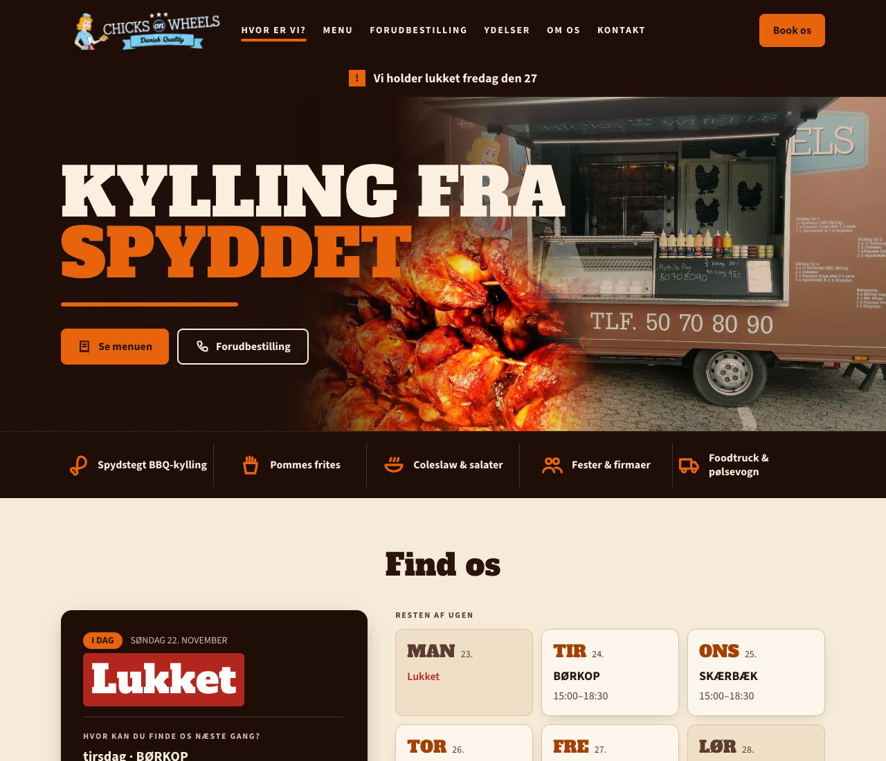
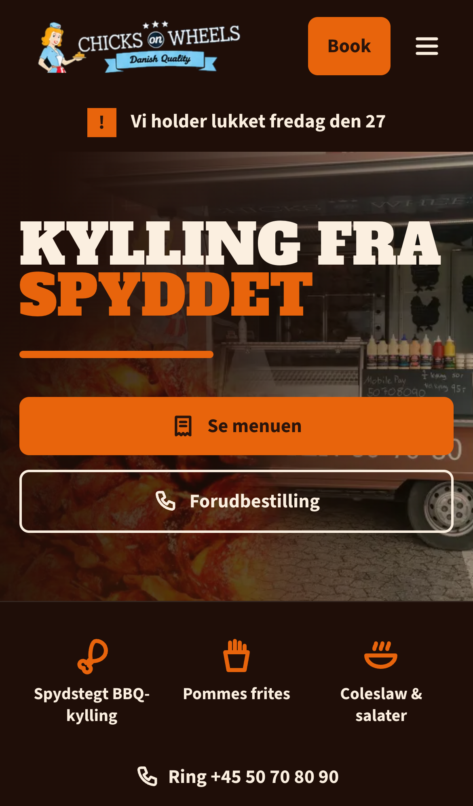
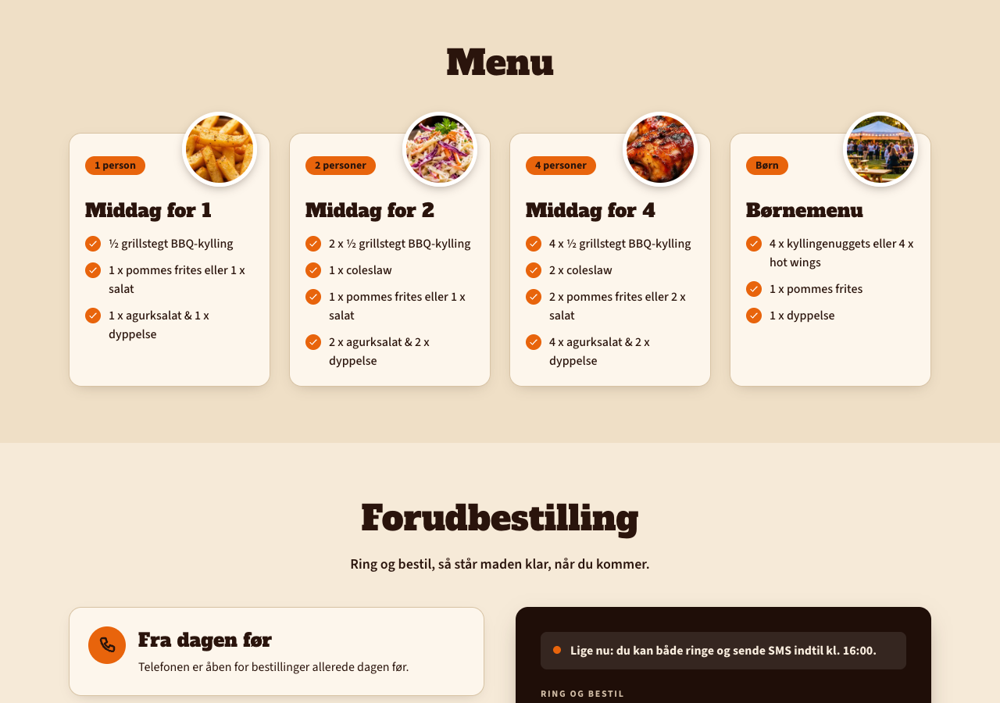
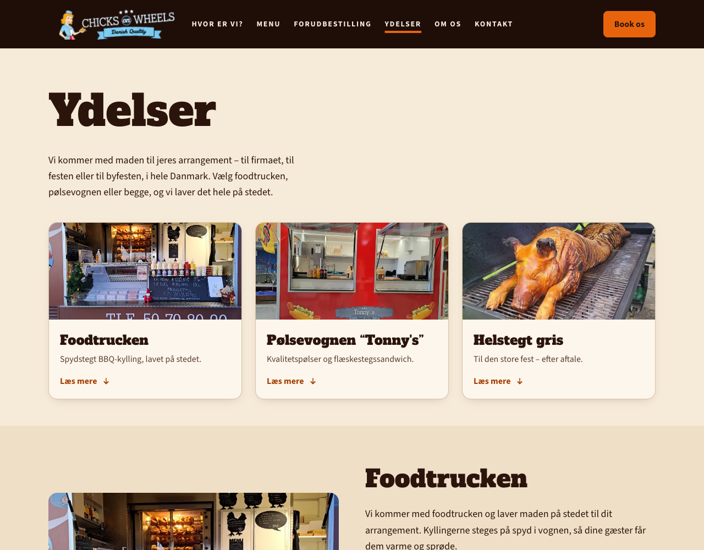
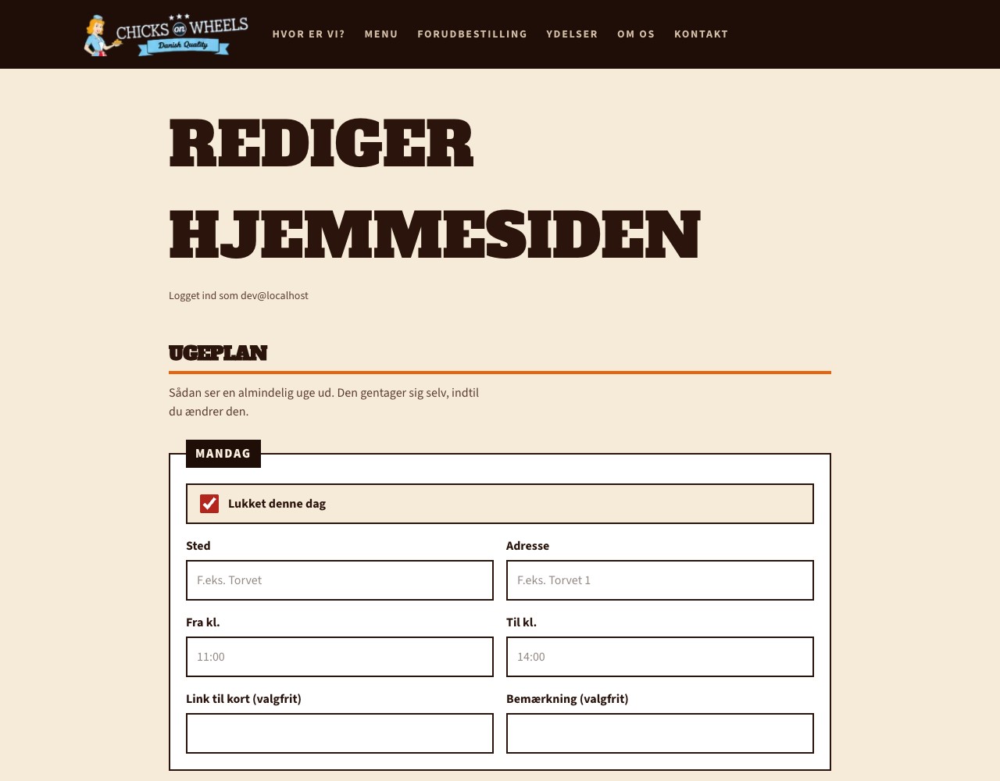

# astro-cloudflare-foodtruck

The website for **Chicks on Wheels**, a Danish food truck selling spit-roasted
BBQ chicken, live at [chicksonwheels.dk](https://chicksonwheels.dk).

The truck parks somewhere different each weekday, so the main job of the site is
answering *"where are you today?"* The owner keeps that up to date herself from a
small admin page on her phone, and visitors always see the current week.

Built with **Astro** and **Tailwind CSS v4**, running on **Cloudflare Workers**,
with the schedule in **D1** and `/admin` protected by **Cloudflare Access**.

| Front page | Mobile |
| --- | --- |
|  |  |

| Menu and pre-ordering | Services |
| --- | --- |
|  |  |

The owner's admin page, where she edits the weekly pattern, one-off exceptions,
holidays and the banner:



## What it does

- **Weekly schedule.** A repeating weekly pattern of stops, plus per-date
  exceptions (closed, or somewhere else). Today's stop is highlighted, and when
  the truck is closed it says where it will be next.
- **Holidays and banner.** Close a whole date range in one go, and show a notice
  across the top of the site until a given date.
- **Pre-ordering.** Tells visitors whether they can still call or text in an
  order today, based on the time in Copenhagen.
- **Booking.** A `/book` page that opens a pre-filled email for events.
- **Admin without a login system.** Cloudflare Access sits in front of `/admin`.
  The Worker only verifies the Access JWT (with `jose`) and fails closed if it's
  missing, invalid, or not configured.
- **Fast pages.** Marketing pages are prerendered; the front page renders per
  request so an edit shows up immediately.

The site copy is in Danish, as are most identifiers for domain concepts
(`ferie` = holiday, `ydelser` = services, `kontakt` = contact).

## Deploy your own

`wrangler.jsonc` has placeholders (`<your-account-id>`, `<your-d1-database-id>`,
`<your-kv-namespace-id>`, `<your-team>`, `<your-access-aud-tag>`) and the real
domain in `routes`. Create your own D1 database and KV namespace with wrangler,
fill those in, and change or remove the routes. Setting up Access is described
in [`docs/access-and-previews.md`](docs/access-and-previews.md). The business
details (phone, email, address) live in `src/lib/kontakt.ts`.

The photos and logo belong to the business and aren't covered by any licence
for reuse.

## View the site locally

```bash
pnpm install
pnpm wrangler d1 migrations apply chicks_on_wheels --local   # first time only
pnpm dev
```

Then open <http://localhost:4321>.

The dev server runs in the background rather than holding the terminal:

```bash
pnpm exec astro dev status   # is it running?
pnpm exec astro dev logs     # what has it printed?
pnpm exec astro dev stop     # shut it down
```

### Give yourself something to look at

A freshly migrated database has seven weekly stops that are all closed, so
every day reads "Lukket". That is correct, but it makes for a dull page.
To fill it in:

```bash
pnpm wrangler d1 execute chicks_on_wheels --local --command \
  "UPDATE weekly_stops SET location_name='Torvet', address='Torvet 1', start_time='11:00', end_time='14:00' WHERE weekday IN (0,1,2,3,4)"
```

Weekday `0` is Monday and `6` is Sunday, so this opens Monday to Friday and
leaves the weekend closed.

An exception overrides the weekly pattern for one date, and the banner shows
across the top of the front page until its end date passes:

```bash
pnpm wrangler d1 execute chicks_on_wheels --local --command \
  "INSERT INTO schedule_exceptions (date, is_closed, location_name, address, start_time, end_time, note)
   VALUES ('2026-08-24', 0, 'Havnen', 'Havnegade 5', '12:00', '18:00', 'Kun i dag')
   ON CONFLICT(date) DO UPDATE SET location_name=excluded.location_name"

pnpm wrangler d1 execute chicks_on_wheels --local --command \
  "INSERT INTO site_settings (key, value) VALUES ('banner_text','Vi holder ferie i uge 34'),('banner_until','2026-08-25')
   ON CONFLICT(key) DO UPDATE SET value=excluded.value"
```

To see what is in the database:

```bash
pnpm wrangler d1 execute chicks_on_wheels --local --command "SELECT * FROM weekly_stops"
```

The local database lives in `.wrangler/` and is git-ignored, so it never
touches the real one. Every command above needs `--local` — without it
wrangler edits production.

## Pages

| Path | Rendered | Notes |
| --- | --- | --- |
| `/` | per request | The schedule. Never cached, so an edit shows up immediately. |
| `/ydelser` | prerendered | Copy lives in the `ydelser` list at the top of `src/pages/ydelser.astro`. |
| `/kontakt` | prerendered | Phone, email and CVR come from `src/lib/kontakt.ts`. |
| `/admin` | per request | Owner only, behind Cloudflare Access. |

`/admin` is open under `pnpm dev` only: the middleware has a dev-only bypass
(`import.meta.env.DEV`) that signs you in as `dev@localhost`. In any deployed build
it returns **403** until `ACCESS_TEAM_DOMAIN` and `ACCESS_AUD` are set, because the
middleware fails closed rather than open.

## Tests

```bash
pnpm test          # unit tests, no network or database
pnpm test:worker   # runs against a real local D1 (builds first)
pnpm test:all      # both
pnpm astro check   # types, including inside .astro files
```

## Deploying

Push to `main`. Cloudflare Workers Builds applies remote migrations and deploys.

`pnpm deploy` does the same thing by hand.

Operational notes — rolling back, inspecting the database, repairing the
schedule by hand — are in [`docs/runbook.md`](docs/runbook.md).
How the site fits together is in [`architecture.md`](architecture.md).
