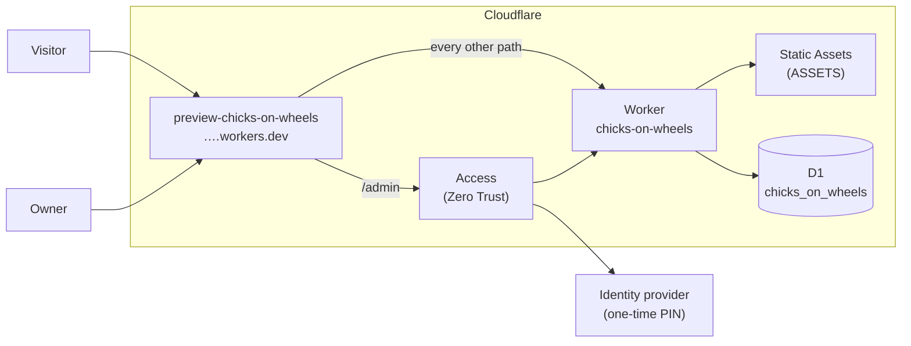
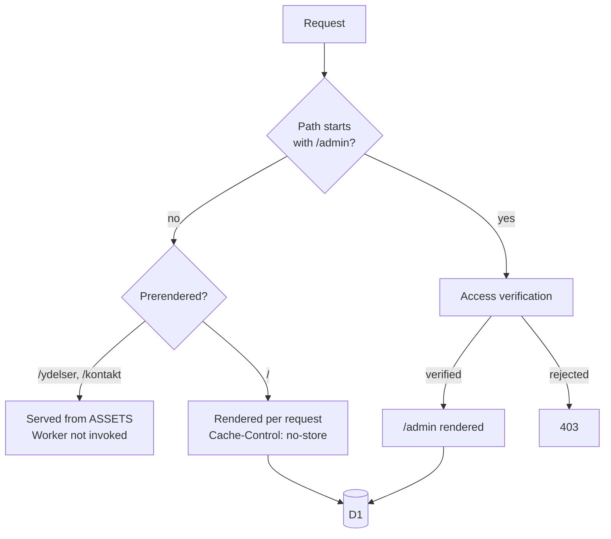
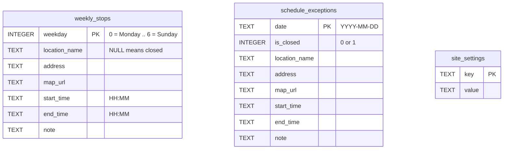
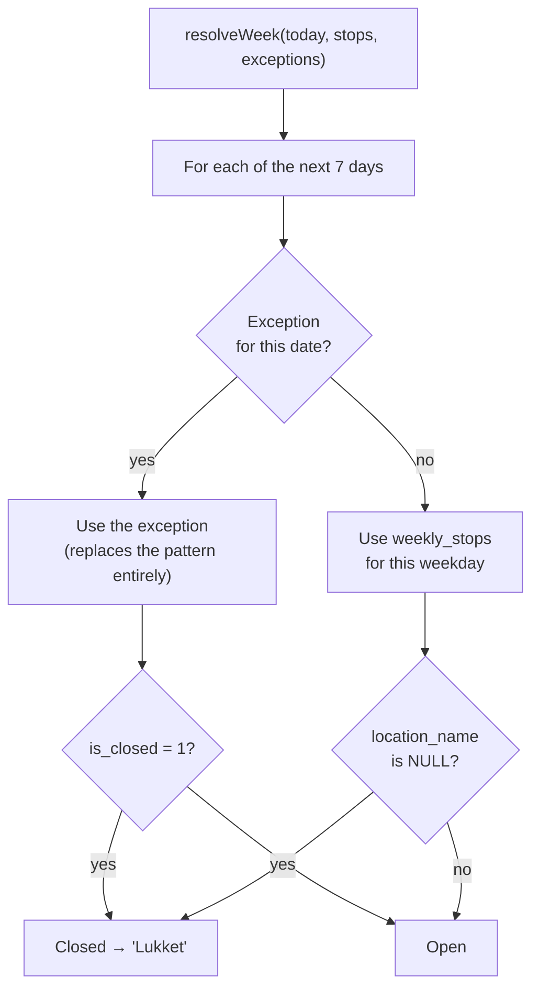
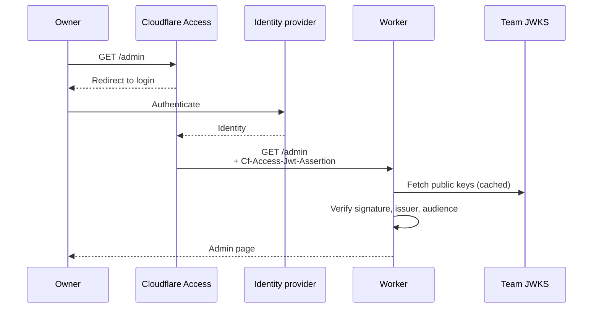
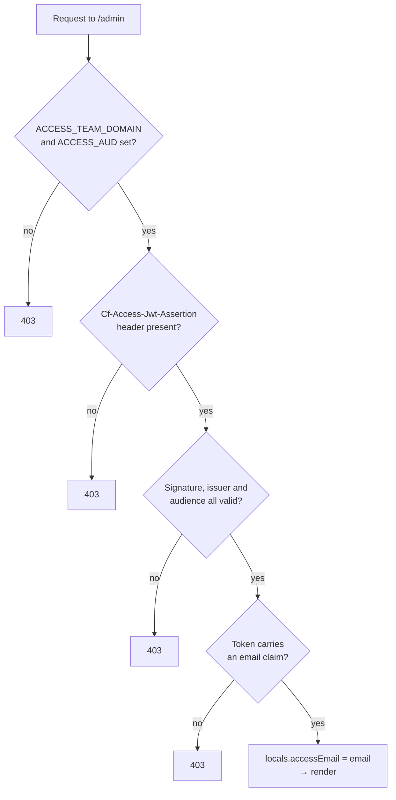
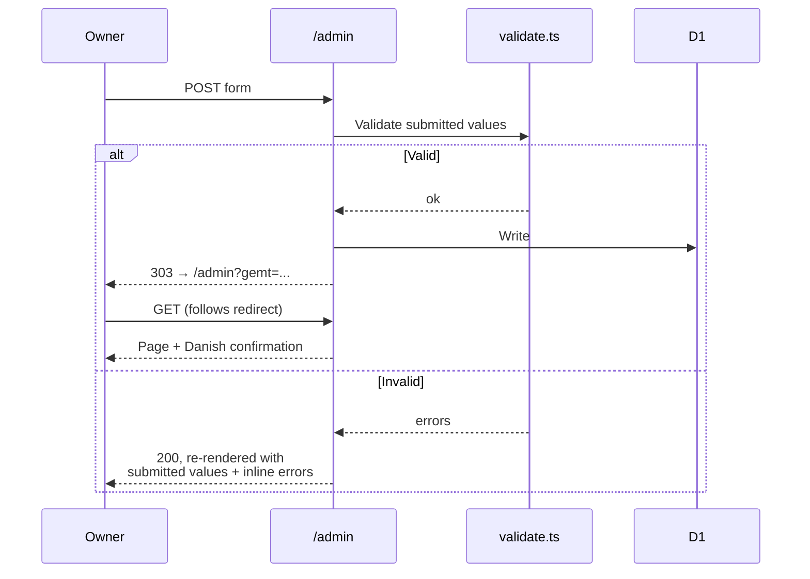
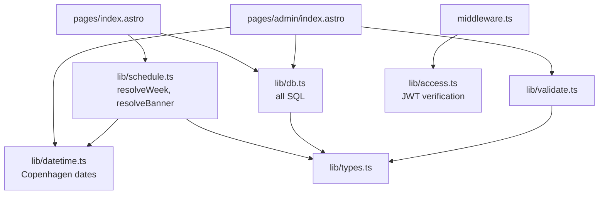
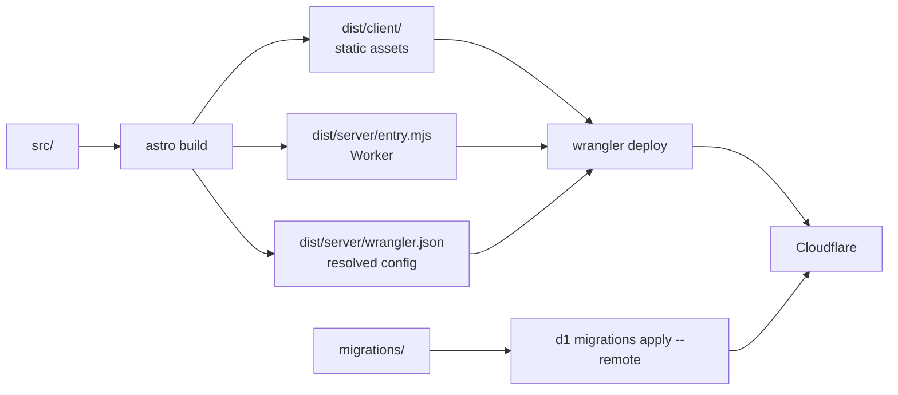
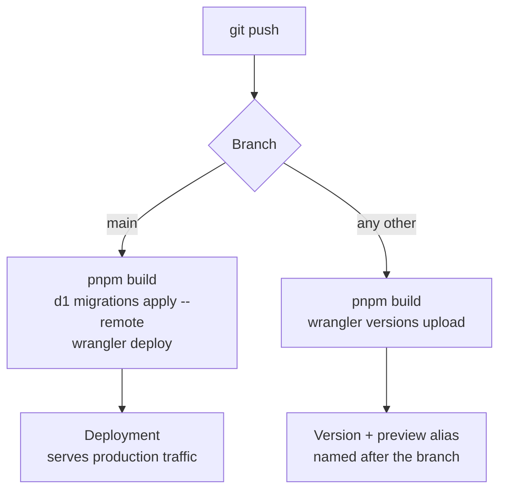

# Architecture

The Chicks on Wheels website. A customer-facing site showing where the food truck
is this week, and a single admin screen where the owner edits it.

## System overview



Everything runs on Cloudflare. There is no origin server and no separate API.

The public site is `https://chicksonwheels.dk` (and `www.`), attached as Worker
custom domains. The `preview` branch is served on the `workers.dev` preview
hostname listed under [Cloudflare resources](#cloudflare-resources).

## Technology

| Layer | Choice |
| --- | --- |
| Framework | Astro 7 (`output: 'server'`) |
| Adapter | `@astrojs/cloudflare` 14 |
| Styling | Tailwind CSS v4 via `@tailwindcss/vite` |
| Runtime | Cloudflare Workers with Static Assets |
| Database | Cloudflare D1 (SQLite) |
| Auth | Cloudflare Access + `jose` for JWT verification |
| Language | TypeScript |
| Tests | Vitest, plus `@cloudflare/vitest-pool-workers` |
| Package manager | pnpm |

## Cloudflare resources

| Resource | Name / binding | Purpose |
| --- | --- | --- |
| Worker | `chicks-on-wheels` | Serves the site |
| Account | `<your-account-id>` | Pinned as `account_id` in `wrangler.jsonc` |
| D1 database | `chicks_on_wheels` (`febb47ab-…`), bound as `DB` | Schedule, exceptions, settings |
| Static assets | bound as `ASSETS` | Prerendered pages, CSS, images |
| Access application | Self-hosted, destinations `chicksonwheels.dk/admin`, `www.chicksonwheels.dk/admin` and `preview-chicks-on-wheels.<your-subdomain>.workers.dev/admin` (one app, one AUD) | Owner authentication |
| Zero Trust team | `<your-team>.cloudflareaccess.com` | Issues the Access tokens |
| KV namespace | `SESSION` (`9b480927…`) | Provisioned by the adapter, id pinned |
| Images | `IMAGES` | Provisioned by the adapter |
| DNS zone | `chicksonwheels.dk` (Free plan, nameservers `jill` / `vicente`.ns.cloudflare.com) | Owned by the owner, registrant-managed at Punktum dk; no registrar chosen yet (required by 30 June 2028) |

Worker configuration lives in `wrangler.jsonc`.

| Setting | Value |
| --- | --- |
| `workers_dev` | `false` — there is no `chicks-on-wheels.<subdomain>.workers.dev` hostname |
| `preview_urls` | `true` — versioned and aliased preview hostnames are served |
| `observability` | enabled |
| `compatibility_date` | `2026-08-22`, flag `nodejs_compat` |
| `routes` | custom domains `chicksonwheels.dk` and `www.chicksonwheels.dk` (zone on Cloudflare, nameservers `jill` / `vicente`) |

The hostnames that currently reach the Worker, both on the
`<your-subdomain>.workers.dev` subdomain:

| Hostname | Created by |
| --- | --- |
| `<version-prefix>-chicks-on-wheels…` | Every uploaded version, including production deploys |
| `preview-chicks-on-wheels…` | The `preview` alias, moved by each upload that names it |

Two variables configure authentication. Neither is a secret; both are plain
`vars` in `wrangler.jsonc` and ship with the version that carries them.

| Variable | Value |
| --- | --- |
| `ACCESS_TEAM_DOMAIN` | `<your-team>.cloudflareaccess.com` |
| `ACCESS_AUD` | `<your-access-aud-tag>` — the application's Application Audience (AUD) tag, 64 hex characters |

Setup steps for Access, preview URLs and git builds are in
[`docs/access-and-previews.md`](docs/access-and-previews.md).

## Routes



| Path | Rendering | Notes |
| --- | --- | --- |
| `/` | Per request | The schedule. `Cache-Control: no-store`, so an edit is visible immediately. |
| `/ydelser` | Prerendered | Copy comes from the lists at the top of `src/pages/ydelser.astro`. |
| `/kontakt` | Prerendered | Phone, e-mail, indehaver, and a link to the kontrolrapporter on findsmiley.dk. |
| `/admin` | Per request | Owner only. `Cache-Control: no-store`. |

The footer renders on every page and carries the registered company name
(`Kvik Kyllinger`), the CVR-nummer and the registered address, all from
`lib/kontakt.ts`.

## Design

The look is one direction carried across every page: a market stall. Black
bands, a mustard ticket for today, tomato for anything urgent, bone for the
page. Details live in `src/styles/global.css`, which is the only place a colour,
a type size or a shadow is defined.

| | |
| --- | --- |
| Tokens | `@theme` in `src/styles/global.css`. Tailwind v4 has no config file. |
| Palette | `sort` `#111111`, `gul` `#FFC526`, `tomat` `#E8341F` / `tomat-dyb` `#C2260F`, `ben` `#F4F1EA`, plus `rist` and `dis` for secondary text |
| Type | Archivo 400–900 (variable, latin) and Roboto Mono 500 (subset), self-hosted in `public/fonts`, preloaded, 42.7 kB together |
| Utilities | `ternet` (the chequer band), `hak-top` / `hak-bund` (punched ticket edges), `skiltbrud` (long-word wrapping) |
| Illustration | Hand-authored SVG in `src/components/art/`. Colours are CSS custom properties, so the same hen renders on black, on mustard and on white. See [`docs/illustrations.md`](docs/illustrations.md). |
| Client JavaScript | None, except the inline `confirm()` on the admin delete button. |

`tomat` and `tomat-dyb` are the same red at two lightnesses on purpose: the
bright one is 3.9:1 on bone and is only allowed at display sizes or as a
background, the dark one is 5.2:1 and is what small text uses.

## Data model



`weekly_stops` holds exactly seven rows. `0001_initial.sql` inserts all seven as
closed; `0002_seed_weekly_stops.sql` fills weekdays 1–4 (Tuesday to Friday) with
the current pattern and leaves 0, 5 and 6 closed. The admin screen only ever
updates them, so a weekday can never go missing.

`schedule_exceptions` holds at most one row per calendar date.

`site_settings` is a key/value table. The site reads `banner_text` and
`banner_until`. `setSettings` writes them with `INSERT … ON CONFLICT DO UPDATE`,
so a database where the banner has never been saved holds no rows at all, and
`getSettings` returns an empty record.

It also holds one holiday: `ferie_fra` and `ferie_til` (inclusive, `YYYY-MM-DD`).
Every day in that range resolves as closed with the note *Ferie*, unless a
`schedule_exceptions` row exists for that date — the exception still wins. Saving
a holiday in /admin also sets the banner (pre-filled from the dates, editable)
to run until the last holiday day. Like the banner, the holiday is ignored once
`ferie_til` has passed. Logic: `src/lib/ferie.ts`, `validateFerie` in
`src/lib/validate.ts`.

## Schedule resolution

The front page shows a rolling seven-day window starting with today, not a
Monday-to-Sunday calendar week.



An exception replaces the pattern entry entirely; the two are never merged, so
no address, map link, or time from the weekly pattern leaks into a day the owner
has overridden.

`resolveWeek` takes today's date as an argument and performs no I/O, so every
rule above is covered by unit tests.

### Time zone

Workers run in UTC. Dates are computed in `Europe/Copenhagen` via
`todayInCopenhagen()`, which formats the current instant in that zone. Without
this, the site would roll over to the next day's location at 22:00 or 23:00
local time depending on daylight saving.

### Banner

`resolveBanner` returns a banner only when `banner_text` is non-empty **and**
`banner_until` is on or after today. A forgotten message expires on its own.

## Authentication

Cloudflare Access sits in front of `/admin`. The Worker contains no login code,
no password handling, and no session store.

The Access application is self-hosted and scoped to a hostname and path rather
than to the Worker, so it intercepts `/admin` and leaves the rest of the site
untouched. It has one destination,
`preview-chicks-on-wheels.<your-subdomain>.workers.dev/admin`.
An application's AUD tag is fixed for its lifetime and does not change when
destinations are added or removed.

The only login method enabled in Zero Trust is **one-time PIN**: Access mails a
code to the address entered on the login page, and the address must appear in
the application's Allow policy. The Cloudflare identity provider is disabled.



The middleware in `src/middleware.ts` guards every path under `/admin` and lets
all other paths through untouched.



Verification uses `jose`. The token is checked against the team's published keys
at `https://<team-domain>/cdn-cgi/access/certs`, with both `issuer` and
`audience` pinned. Key sets are cached per issuer.

The header alone proves nothing — anything that can reach the Worker directly
can set it — so the signature is always verified. Verification runs on every
`/admin` request whatever hostname served it, so a preview hostname that no
Access destination covers receives no token and gets the same 403.
`workers_dev: false` keeps the Worker off the plain
`chicks-on-wheels.<subdomain>.workers.dev` hostname.

Every failure mode — missing header, bad signature, wrong issuer, wrong
audience, expired token, no email claim, unset configuration — produces the same
403 response.

## Admin page

One page, `/admin`, containing three independent forms. Each posts back to
`/admin` and is distinguished by a hidden `_form` field.

| `_form` value | Action |
| --- | --- |
| `weekly` | Save all seven weekday rows |
| `exception` | Add or replace an exception for one date |
| `delete-exception` | Remove one exception |
| `banner` | Save or clear the front-page message |



The successful path is POST-redirect-GET, so refreshing the page after a save
cannot repeat it.

The failing path re-renders in place with everything the owner typed still
present, including checkbox state, and the Danish error message beside the field
it belongs to. An unchecked checkbox submits no value at all, so its state is
threaded through explicitly rather than derived.

The weekly form saves all seven days or none. A partial save would leave a
half-updated week.

The page works with JavaScript disabled. The only script on it is the
`confirm()` on the delete button, which degrades to a normal submit.

Astro's `security.checkOrigin` rejects cross-site form POSTs before they reach
the page, which protects all four actions against CSRF.

## Validation

`src/lib/validate.ts` holds every rejection rule as a pure function returning
`{ ok: true, value }` or `{ ok: false, errors }`. Messages are Danish and name
the field they belong to.

| Rule | Message |
| --- | --- |
| Open day with no location | `Skriv hvor I holder.` |
| Malformed time | `Skriv tidspunktet som f.eks. 11:00.` |
| Missing opening time | `Skriv hvornår I åbner.` |
| End not after start | `Sluttidspunktet skal være efter starttidspunktet.` |
| Exception date in the past | `Datoen er allerede passeret.` |
| Banner text with no end date | `Vælg hvor længe beskeden skal vises.` |

Times must be `HH:MM` in 24-hour form. Dates must be real calendar dates.

## Module map



| Module | Responsibility |
| --- | --- |
| `lib/datetime.ts` | Copenhagen date arithmetic, Danish weekday names and date formatting |
| `lib/schedule.ts` | Turns the pattern plus exceptions into seven days; resolves the banner |
| `lib/db.ts` | Every SQL statement in the project |
| `lib/validate.ts` | All form rejection rules |
| `lib/access.ts` | Access JWT verification |
| `lib/kontakt.ts` | Phone, e-mail, indehaver, registered company name, CVR-nummer and address, and the findsmiley.dk link |
| `lib/preorder.ts` | The pre-order SMS cutoff (`SMS_DEADLINE`, `smsIsOpen`) |
| `lib/types.ts` | Shared row and view types |
| `middleware.ts` | Guards `/admin` |

`lib/db.ts` is the only module containing SQL. Every statement uses bound
parameters.

## Failure behaviour

If D1 is unavailable, the front page renders a Danish notice and the phone
number instead of a schedule. It never shows a blank or stale week, since a
customer could drive to it.

## Build and deploy



```bash
pnpm deploy   # astro build → apply remote migrations → wrangler deploy
```

Schema changes are numbered SQL files in `migrations/`, applied with
`wrangler d1 migrations apply`.

### Git-connected builds

The repository `github.com/himsen/chicks-on-wheels` is connected to Workers
Builds. A push builds and then runs one of two commands, depending on the
branch.

| Setting | Value |
| --- | --- |
| Build command | `pnpm build` |
| Production branch | `main` |
| Deploy command | `pnpm wrangler d1 migrations apply chicks_on_wheels --remote && pnpm wrangler deploy` |
| Builds for non-production branches | enabled |
| Non-production branch deploy command | `pnpm wrangler versions upload` |



A non-production build creates a version and an alias named after the branch;
it does not change what production serves and does not apply migrations. The
`preview` branch therefore publishes
`preview-chicks-on-wheels.<your-subdomain>.workers.dev`.

Preview versions use the bindings in `wrangler.jsonc`: the same D1 database and
the same KV namespace as production.

An alias can also be moved without git:

```bash
pnpm build
pnpm wrangler versions upload --preview-alias preview
```

## Tests

| Command | Scope |
| --- | --- |
| `pnpm test` | Unit tests — dates, schedule resolution, validation, JWT verification. No network or database. |
| `pnpm test:worker` | Builds the Worker and runs it against a real local D1 with migrations applied. |
| `pnpm test:all` | Both. |
| `pnpm astro check` | Types, including inside `.astro` files. |

Worker tests fetch the built Worker, so `/admin` returning 403 in those tests is
a check against the same artifact that ships.

Storage in the Worker test pool is isolated per test *file*, not per test.
